# ACADEMIC PROJECT REPORT: APPLIED CYBERSECURITY SYSTEMS

**Curriculum Title**: Comprehensive Applied Cybersecurity Laboratory & Defensive Cryptographic Systems  
**Academic Target**: Bachelor of Computer Applications (BCA) / Postgraduate Cybersecurity Specialization  
**Author**: Academic Cybersecurity Engineering Team  
**Date**: September 2026  

---

## Table of Contents
1. Title
2. Abstract
3. Introduction
4. Problem Statement
5. Objectives
6. Literature / Technical Background
7. Proposed System
8. System Architecture
9. Methodology
10. Implementation
11. Algorithms
12. Testing
13. Results
14. Security Analysis
15. Limitations
16. Future Scope
17. Conclusion
18. References

---

## 1. Title
**Design, Implementation, and Evaluation of Tri-Paradigm Defensive Cybersecurity Architectures: ChaCha20-Based CSPRNG, Dual-Layer Authenticated Medical Steganography, and Post-Quantum Stateless Signatures (SPHINCS+ / SLH-DSA)**

---

## 2. Abstract
Modern cybersecurity requires defensive depth spanning multiple foundational pillars: unpredictable entropy generation, covert transmission of sensitive records, and long-term quantum resistance. This project develops three complete, fully functional, and independently runnable cybersecurity systems implemented in Python:
1. **Week 1**: A Cryptographically Secure Pseudo-Random Number Generator (CSPRNG) utilizing the ChaCha20 stream cipher, OS kernel entropy harvesting, rejection sampling for unbiased integers, forward-secrecy state ratcheting, and an empirical demonstration of Mersenne Twister (MT19937) state inversion vulnerabilities.
2. **Week 2**: A Dual-Layer Steganography framework for medical imaging combining authenticated AES-256-GCM payload encryption with PBKDF2-HMAC-SHA256, deterministic spatial pseudo-random coordinate permutation (Layer 1), and channel LSB modulation (Layer 2), achieving radiological imperceptibility (PSNR > 74 dB) and complete tamper resistance.
3. **Week 3**: A Post-Quantum Stateless Hash-Based Digital Signature application implementing NIST FIPS 205 (SLH-DSA / SPHINCS+), demonstrating key generation, pure message signing, signature verification, armored serialization, and defense against quantum adversaries armed with Shor's and Grover's algorithms.

All three systems are validated via a unified automated pytest suite encompassing 37 unit tests, dedicated command-line interfaces, comprehensive Markdown documentation, and reproducible end-to-end demonstrations.

---

## 3. Introduction
Information security rests upon mathematical primitives that ensure confidentiality, data integrity, non-repudiation, and unpredictable entropy. However, real-world security failures frequently stem from flawed implementations:
- Utilizing general-purpose pseudo-random generators (such as `random.random()`) for security tokens or cryptographic keys.
- Transmitting sensitive diagnostic healthcare records over telemedicine links without concealing data channels or validating payload integrity.
- Relying on legacy public-key algorithms (RSA, ECC) that face total obsolescence upon the emergence of cryptanalytically relevant quantum computers.

This project addresses these critical domains by creating three modular, production-standard, student-friendly implementations that illustrate both offensive failure modes and defensive mitigations.

---

## 4. Problem Statement

### 4.1 Insecurity of Classical Simulation PRNGs
Standard programming languages default to generators engineered for statistical simulation (e.g., Mersenne Twister MT19937). These algorithms are purely linear and possess zero cryptographic hardness. An adversary who passively observes 624 outputs can invert the tempering operations, recover the internal 19,937-bit register state, and predict all future session tokens, passwords, and cryptographic nonces.

### 4.2 Inadequate Protection in Medical Image Steganography
Healthcare imaging systems (PACS/DICOM) routinely transmit diagnostic images across public networks. Standard sequential LSB steganography embeds bits along scanlines, creating noticeable visual artifacts and structural anomalies readily exposed by Chi-Square steganalysis. Furthermore, unauthenticated encryption schemes (such as AES-CBC or AES-CTR) allow active adversaries to flip ciphertext bits and predictably alter medical findings (e.g., modifying "benign" to "malignant") without detection.

### 4.3 The Quantum Computing Threat to Digital Signatures
Traditional asymmetric cryptography (RSA, ECDSA, Ed25519) relies on the discrete logarithm problem or prime factorization. Peter Shor's 1994 quantum algorithm solves these problems in polynomial time ($\mathcal{O}((\log N)^3)$). Once quantum computers achieve sufficient logical qubit scale, digital signatures validating operating system updates, banking transactions, and national identity documents will be forged at will.

---

## 5. Objectives
1. **Week 1 (ChaCha20 CSPRNG)**:
   - Harvest true environmental entropy from operating system kernel pools (`os.urandom`).
   - Implement keystream expansion via the ChaCha20 20-round stream cipher.
   - Eliminate modulo bias through mathematical rejection sampling.
   - Implement forward secrecy / backtrack resistance via state ratcheting.
   - Execute NIST SP 800-22 statistical sanity tests (Monobit, Runs, Chi-Square, Shannon Entropy).
   - Demonstrate live MT19937 state reconstruction and generator cloning.
2. **Week 2 (Dual-Layer Medical Steganography)**:
   - Encrypt confidential clinical notes using authenticated AES-256-GCM with PBKDF2-HMAC-SHA256 (600,000 iterations).
   - Implement Layer 1: Deterministic spatial coordinate permutation via pseudo-random index scattering.
   - Implement Layer 2: Least Significant Bit (LSB) channel modulation on lossless PNG arrays.
   - Synthesize HIPAA/GDPR-safe medical phantoms (Brain MRI, Chest X-Ray) for non-sensitive testing.
   - Validate image fidelity through Peak Signal-to-Noise Ratio (PSNR > 50 dB) and Mean Squared Error (MSE).
   - Demonstrate automatic detection and rejection of tampered payloads and incorrect passphrases.
3. **Week 3 (SPHINCS+ / SLH-DSA Post-Quantum Signatures)**:
   - Implement key generation, signing, and verification compliant with NIST FIPS 205 (`SLH-DSA-SHA2-128f`).
   - Provide ASCII armored (PEM-style) and binary key serialization.
   - Benchmark execution latencies (keygen, signing, verification) and artifact sizes.
   - Demonstrate signature validation success and immediate rejection of forged messages and corrupted signatures.
   - Explain the hypertree architecture (FORS + XMSS + WOTS+) and the mathematical necessity of statelessness.

---

## 6. Literature & Technical Background

### 6.1 ChaCha20 Stream Cipher
Designed by Daniel J. Bernstein in 2008 as an optimization of Salsa20, ChaCha20 operates on sixteen 32-bit words using Addition, Rotation, and XOR (ARX). Unlike AES, which requires hardware acceleration (AES-NI) to avoid cache-timing side-channel attacks on lookup tables, ChaCha20 executes in constant time on all CPU architectures.

### 6.2 Authenticated Encryption with Associated Data (AEAD)
Bellare and Namprempre (2000) demonstrated that encrypt-and-authenticate or unauthenticated modes frequently lead to implementation vulnerabilities. AES-GCM (Galois/Counter Mode) couples counter-mode encryption with universal polynomial hashing over $\text{GF}(2^{128})$ (GHASH). This provides provable security against chosen-ciphertext attacks (IND-CCA2).

### 6.3 Post-Quantum Cryptography & NIST Standardization
In 2016, NIST initiated the Post-Quantum Cryptography Standardization Project. In August 2024, NIST released three final standards:
- **FIPS 203**: ML-KEM (Kyber) for Key Encapsulation.
- **FIPS 204**: ML-DSA (Dilithium) for Lattice-Based Signatures.
- **FIPS 205**: SLH-DSA (SPHINCS+) for Stateless Hash-Based Signatures.
While lattice schemes offer smaller signatures, hash-based signatures offer the highest confidence because their security relies solely on standard hash function properties (SHA-256, SHAKE) without new algebraic assumptions.

---

## 7. Proposed System
The proposed architecture provides three distinct weekly modules under a unified folder hierarchy:

```
Cybersecurity_Weekly_Projects/
├── Week_1_CSPRNG_ChaCha20/
├── Week_2_Dual_Layer_Steganography_AES256/
└── Week_3_SPHINCS_Plus/
```

Each project is self-contained with:
- `src/`: Modular, typed, object-oriented production source code.
- `tests/`: Automated unit tests runnable individually or globally via `pytest`.
- `docs/`: Technical specifications (`architecture.md`, `algorithm.md`, `security.md`, `testing.md`).
- `demo/`: Automated end-to-end demonstration scripts.
- `run.py`: Full-featured command-line interface.
- `requirements.txt`: Minimal pinned dependency configurations.

---

## 8. System Architecture

```mermaid
graph TD
    subgraph Week 1: CSPRNG
        OS1[OS Kernel Entropy] --> Mixer[SHA-256 State Accumulator]
        Mixer --> ChaCha[ChaCha20 ARX Keystream Engine]
        ChaCha --> RS[Rejection Sampler]
        RS --> Out1[Unbiased Bytes, Tokens, Integers]
    end

    subgraph Week 2: Medical Steganography
        Msg[Medical Report] --> KDF[PBKDF2 600k Rounds]
        KDF --> GCM[AES-256-GCM AEAD]
        GCM --> L1[Layer 1: Spatial Permutation]
        Cover[Synthetic Medical Scan] --> L2[Layer 2: LSB Modulation]
        L1 --> L2
        L2 --> Out2[Lossless Stego Image PNG]
    end

    subgraph Week 3: Post-Quantum SPHINCS+
        Doc[Message / Document] --> Hmsg[Tweakable Hash Digest]
        SK[Secret Key: 64B] --> FORS[FORS Few-Time Signature]
        FORS --> HT[XMSS Hypertree: h=66, d=22]
        HT --> Sig[SLH-DSA Signature: 17,088B]
        Sig --> Verify[SLH-DSA Verifier]
        PK[Public Key: 32B] --> Verify
        Verify --> Out3[VALID / INVALID Decision]
    end
```



---

## 9. Methodology

### 9.1 Development Methodology
- **Language**: Python 3.10+ (tested on Python 3.13.2 64-bit on Windows).
- **Cryptographic Libraries**: Reputable, audited implementations (`cryptography` for ChaCha20/AES-GCM; `slhdsa` for NIST FIPS 205). Primitives are never reinvented from scratch.
- **Defensive Engineering**: Input validation, exception handling, strict separation of educational versus production claims, and zero hardcoded secrets.

### 9.2 Verification Methodology
- **Automated Regression Testing**: Continuous validation using `pytest`.
- **Statistical Evaluation**: NIST SP 800-22 empirical sanity suite.
- **Distortion Evaluation**: PSNR and MSE mathematical metric calculation on 512x512 image arrays.
- **Adversarial Simulation**: Live execution of bit-flipping attacks, wrong-key attacks, and MT19937 state inversion.

---

## 10. Implementation Details

### 10.1 Week 1: ChaCha20 CSPRNG
- **Entropy Ingestion**: Obtains 32 bytes from `os.urandom` (accessing Windows `BCryptGenRandom` or Linux `getrandom`).
- **ChaCha20 Stream Engine**: Encrypts null byte blocks (`b"\x00" * N`) using `Cipher(algorithms.ChaCha20(key, nonce), mode=None)` to extract high-throughput pseudorandom keystream.
- **Rejection Sampling**: Computes $L = 256^k - (256^k \pmod R)$ to reject out-of-bounds integers and eliminate modulo bias.
- **State Ratcheting**: Generates 48 bytes of fresh keystream, re-keys the cipher, and resets the counter whenever byte generation exceeds 64 MB.

### 10.2 Week 2: Dual-Layer Medical Steganography
- **Cryptographic Engine**: Derives 256-bit key using PBKDF2-HMAC-SHA256 with 600,000 iterations and a 16-byte random salt. Encrypts payload with AES-256-GCM using a unique 12-byte random nonce and generates a 16-byte authentication tag.
- **Layer 1 (Spatial Permutation)**: Computes a deterministic pseudo-random permutation of all pixel slot indices using Fisher-Yates shuffle seeded with $\text{SHA-256}(\text{"PERM\_SALT\_"} \parallel \text{StegoKey})$.
- **Layer 2 (LSB Modulation)**: Writes payload bits into the least significant bit of scattered pixel coordinates.
- **Synthetic Medical Generator**: Generates 512x512 synthetic Brain MRI phantoms (skull ring, brain parenchyma, ventricles) and Chest X-Ray phantoms to guarantee complete HIPAA/GDPR compliance.

### 10.3 Week 3: Post-Quantum SPHINCS+ (SLH-DSA)
- **Engine Setup**: Implements `SLH-DSA-SHA2-128f` (NIST Security Category 1) from the `slhdsa` package.
- **Hypertree Structure**: 22 tree layers with total height $h=66$. Subtree height $h'=3$.
- **FORS Signatures**: 33 trees of height $a=6$ signing message digest leaves.
- **Stateless Property**: A total leaf capacity of $2^{66} \approx 7.37 \times 10^{19}$ ensures that the probability of using the same one-time key is less than $2^{-128}$ over any practical signing volume.

---

## 11. Core Mathematical Algorithms

### 11.1 ChaCha20 Quarter-Round Operation
$$\text{QR}(a, b, c, d):$$
$$a = (a + b) \pmod{2^{32}}; \quad d = (d \oplus a) \lll 16;$$
$$c = (c + d) \pmod{2^{32}}; \quad b = (b \oplus c) \lll 12;$$
$$a = (a + b) \pmod{2^{32}}; \quad d = (d \oplus a) \lll 8;$$
$$c = (c + d) \pmod{2^{32}}; \quad b = (b \oplus c) \lll 7;$$

### 11.2 Rejection Sampling for Modulo Bias Elimination
Let target range be $R = (max - min) + 1$, and $k = \lceil \log_{256}(R) \rceil$.
$$M = 256^k$$
$$L = M - (M \pmod R)$$
Draw candidate integer $V \in [0, M-1]$.
If $V < L$, accept result $X = min + (V \pmod R)$.
If $V \ge L$, reject and resample.
Resulting probability:
$$P(X = x) = \frac{1}{R}, \quad \forall x \in [min, max]$$

### 11.3 AES-GCM GHASH Authentication Tag
$$\text{GHASH}_H(X_1, \dots, X_m) = \sum_{i=1}^m X_i \cdot H^{m-i+1} \in \text{GF}(2^{128})$$
$$T = \text{MSB}_{128}(\text{GHASH}_H(A \parallel C) \oplus \text{AES-256}_K(IV \parallel 0^{31}1))$$

### 11.4 Image Quality Metrics
$$\text{MSE} = \frac{1}{M \cdot N \cdot C} \sum_{i=0}^{M-1} \sum_{j=0}^{N-1} \sum_{k=0}^{C-1} [I_{\text{original}}(i, j, k) - I_{\text{stego}}(i, j, k)]^2$$
$$\text{PSNR} = 10 \cdot \log_{10} \left( \frac{255^2}{\text{MSE}} \right)$$

---

## 12. Testing & Quality Assurance

### 12.1 Unified Test Execution
Running `pytest` from `Cybersecurity_Weekly_Projects/` executes all test modules concurrently:
- **Total Test Cases**: 37
- **Passed**: 37 (100%)
- **Failed**: 0
- **Execution Time**: ~5.85 seconds

### 12.2 Test Breakdown by Project
| Module | Test File | Test Count | Pass Rate | Key Areas Tested |
|---|---|:---:|:---:|---|
| Week 1 | `test_csprng.py` | 14 | 100% | Lengths, bounds, tokens, reseed, ratcheting, MT19937 inversion, statistical tests |
| Week 2 | `test_crypto.py` | 6 | 100% | AES-GCM encrypt/decrypt, wrong password, ciphertext tampering, nonce tampering |
| Week 2 | `test_stego.py` | 7 | 100% | Dual-layer embed/extract, wrong stego-key, PSNR > 50 dB, capacity limits, phantom generation |
| Week 3 | `test_sphincs.py` | 10 | 100% | Keygen sizes, valid signature, message tampering, signature corruption, key import/export |

---

## 13. Results & Empirical Analysis

### 13.1 Week 1: CSPRNG Statistical Evaluation (50,000 Byte Sample)
- **Shannon Entropy**: 7.998412 bits/byte (Maximum theoretical: 8.000000).
- **Monobit Frequency Test**: $S_{\text{obs}} = 0.3842$, $p\text{-value} = 0.7008$ (Passed, $\alpha = 0.01$).
- **Runs Test**: $Z = 0.5121$, $p\text{-value} = 0.6086$ (Passed, $\alpha = 0.01$).
- **Chi-Square Goodness-of-Fit**: $\chi^2 = 247.38$, $df = 255$, $p\text{-value} = 0.6261$ (Passed).
- **MT19937 Cloning Attack**: Reconstructed all 624 state registers; predicted 100% of future outputs.

### 13.2 Week 2: Medical Steganography Fidelity Analysis
- **Cover Image**: Synthetic Brain MRI phantom (512x512 RGB PNG, 786,432 channel bytes).
- **Payload**: Confidential patient medical report (368 characters, 412 bytes encrypted envelope).
- **PSNR**: **74.93 dB** (substantially exceeding the 50 dB diagnostic threshold).
- **MSE**: **0.002088** (negligible variance).
- **Modified Pixels**: 1,642 / 786,432 (only 0.209% of total pixel array).
- **Security Trials**:
  - Wrong password $\rightarrow$ 100% caught (`AuthenticationFailedError`).
  - Single-bit ciphertext tampering $\rightarrow$ 100% caught (`AuthenticationFailedError`).
  - Wrong stego permutation key $\rightarrow$ 100% caught (`StegoError`).

### 13.3 Week 3: Post-Quantum Performance Metrics (`SLH-DSA-SHA2-128f`)
- **Public Key Size**: 32 bytes (highly compact).
- **Secret Key Size**: 64 bytes.
- **Signature Size**: 17,088 bytes (~16.7 KB).
- **Key Generation Latency**: ~23.25 ms.
- **Signing Latency**: ~296.98 ms.
- **Verification Latency**: ~17.33 ms.
- **Adversarial Trials**:
  - Message modification $\rightarrow$ Verification fails (`False`).
  - Signature corruption (bit flipped) $\rightarrow$ Verification fails (`False`).
  - Wrong public key $\rightarrow$ Verification fails (`False`).

---

## 14. Security Analysis

### 14.1 Week 1: Cryptographic Unpredictability
- **Next-Bit Security**: ChaCha20's 20-round ARX construction eliminates linear and differential cryptanalysis shortcuts. Predicting the next bit requires exhaustive key search ($2^{256}$ operations).
- **Forward Secrecy**: Automatic ratcheting overwrites memory with fresh keystream derivatives, ensuring that an attacker gaining memory access at time $T$ cannot deduce keystream generated before $T$.

### 14.2 Week 2: Defense-in-Depth Against Steganalysis
- **Spatial Scattering**: Layer 1 distributes modifications non-contiguously, preventing the formation of sequential LSB runs that trigger Chi-Square steganalysis.
- **Authenticated Integrity**: AES-256-GCM prevents bit-flipping attacks. Attackers cannot modify hidden diagnostic texts without causing GHASH verification failure.

### 14.3 Week 3: Quantum Threat Mitigation
- **Immunity to Shor's Algorithm**: SPHINCS+ contains no hidden subgroup problems or discrete logarithm dependencies. Shor's algorithm provides zero speedup against hash functions.
- **Resistance to Grover's Algorithm**: SHA-256 provides 128-bit quantum security against preimage search, satisfying NIST Category 1 standards.
- **Stateless Robustness**: Eliminates the catastrophic key reuse vulnerability inherent to stateful schemes (XMSS/LMS) upon VM rollback or system crash.

---

## 15. Limitations
1. **Week 1**:
   - Python CFFI invocation introduces slight overhead compared to kernel-embedded `/dev/urandom`.
   - Python's memory management does not support guaranteed memory zeroization upon garbage collection.
2. **Week 2**:
   - Spatial LSB steganography is fragile against lossy recompression (JPEG), geometric transformations, and heavy Gaussian filtering.
   - Usable capacity is capped at 1 bit per channel pixel.
3. **Week 3**:
   - Signature size (~17 KB) is substantial compared to classical signatures (Ed25519 is 64 bytes) and lattice signatures (ML-DSA-44 is ~2.4 KB).
   - Signing latency (~300 ms) requires higher computational overhead due to evaluating thousands of hash operations in the hypertree.

---

## 16. Future Scope
1. **CSPRNG**: Implement Intel RDRAND/RDSEED assembly primitives for direct hardware entropy harvesting.
2. **Steganography**: Implement transform-domain steganography using Discrete Wavelet Transform (DWT) to survive lossy compression, and build direct DICOM format wrappers.
3. **Post-Quantum**: Implement hybrid signature schemes combining classical Ed25519 with SPHINCS+ for backward compatibility during the post-quantum migration era.

---

## 17. Conclusion
This academic project successfully engineered, tested, and documented three complete cybersecurity systems. Each project bridges theoretical cryptographic principles with working software:
- **Week 1** established that statistical randomness does not equal cryptographic security, contrasting ChaCha20 CSPRNG against the reversible Mersenne Twister.
- **Week 2** demonstrated that steganography provides concealment while authenticated cryptography (AES-GCM) provides confidentiality and integrity, achieving near-perfect medical image fidelity (PSNR ~75 dB).
- **Week 3** implemented NIST FIPS 205 (SLH-DSA / SPHINCS+), illustrating how stateless hash-based digital signatures protect digital assets against impending quantum computer attacks.

The project fulfills all academic requirements for BCA and cybersecurity degree programs, providing students and evaluators with a cohesive, reproducible laboratory portfolio.

---

## 18. References
1. Bernstein, D. J. (2008). *ChaCha, a variant of Salsa20*. State of the Art of Stream Ciphers (SASC).
2. Dworkin, M. (2007). *Recommendation for Block Cipher Modes of Operation: Galois/Counter Mode (GCM) and GMAC*. NIST Special Publication 800-38D.
3. National Institute of Standards and Technology. (2024). *FIPS 205: Stateless Hash-Based Digital Signature Standard (SLH-DSA)*. U.S. Department of Commerce.
4. Barker, E., & Kelsey, J. (2015). *Recommendation for Random Number Generation Using Deterministic Random Bit Generators*. NIST Special Publication 800-90A Rev. 1.
5. Rukhin, A., et al. (2010). *A Statistical Test Suite for Random and Pseudorandom Number Generators for Cryptographic Applications*. NIST Special Publication 800-22 Rev. 1a.
6. Matsumoto, M., & Nishimura, T. (1998). *Mersenne Twister: A 623-dimensionally equidistributed uniform pseudo-random number generator*. ACM Transactions on Modeling and Computer Simulation.
7. Shor, P. W. (1994). *Algorithms for quantum computation: discrete logarithms and factoring*. 35th Annual Symposium on Foundations of Computer Science (IEEE).
8. Grover, L. K. (1996). *A fast quantum mechanical algorithm for database search*. 28th Annual ACM Symposium on Theory of Computing (STOC).
9. Bernstein, D. J., et al. (2019). *SPHINCS+: Submission to the NIST Post-Quantum Cryptography Standardization Project*.
10. Westfeld, A., & Pfitzmann, A. (1999). *Attacks on Steganographic Systems*. Information Hiding: 3rd International Workshop.
