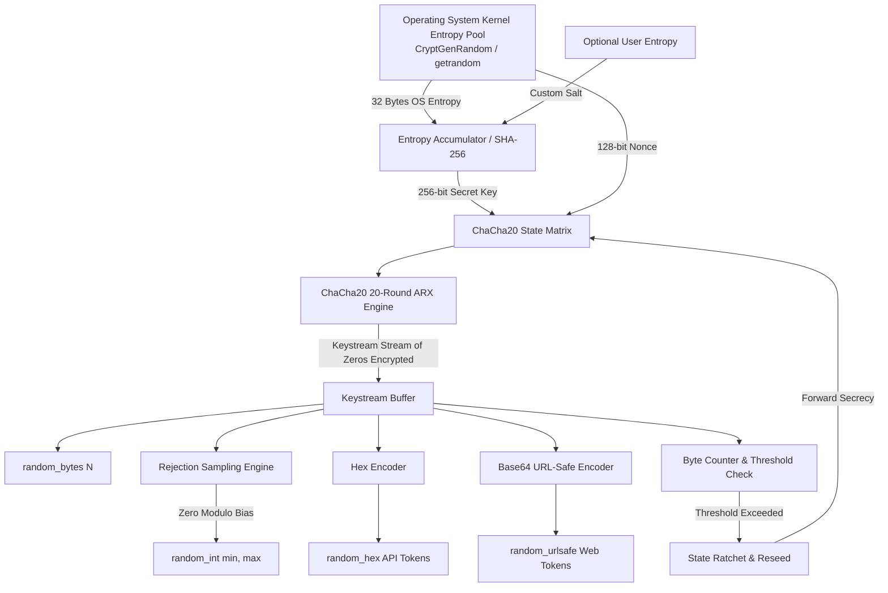

# Cryptographically Secure Pseudo-Random Number Generator (CSPRNG) Using ChaCha20

## 1. Project Title
**Cryptographically Secure Pseudo-Random Number Generator (CSPRNG) Using ChaCha20**

## 2. Objective
To design, implement, and validate a production-grade yet student-friendly Cryptographically Secure Pseudo-Random Number Generator (CSPRNG) based on the ChaCha20 stream cipher. The system provides secure random bytes, unbiased bounded integers, cryptographic hex tokens, URL-safe tokens, forward secrecy ratcheting, empirical statistical sanity testing, and a live demonstration of why standard non-cryptographic PRNGs fail catastrophically in security applications.

## 3. Problem Statement
Ordinary random number generators, such as Python's default `random` module (which implements the Mersenne Twister MT19937), are engineered exclusively for Monte Carlo simulations, gaming, and statistical modeling. They completely lack cryptographic hardness. An adversary observing just 624 outputs of 32-bit values can invert the tempering transformations, reconstruct the entire internal state (19,937 bits), and perfectly predict all future and past outputs. Using ordinary generators for cryptographic keys, session IDs, salt generation, nonces, or password reset tokens leads to complete system compromise. A dedicated CSPRNG with backward and forward secrecy is required.

## 4. Background & Core Concepts
- **Entropy**: Measure of uncertainty or unpredictability collected from non-deterministic physical phenomena (hardware interrupts, thermal noise, disk I/O timings) by the operating system kernel pool (`os.urandom`, Windows `BCryptGenRandom`, Linux `getrandom`).
- **Seed**: An initial input secret of sufficient entropy used to place the generator in an unpredictable internal state. In this project, a 256-bit OS entropy seed initializes the ChaCha20 key.
- **Nonce (Number used ONCE)**: A unique value ensuring that even if the same key is reused, the resulting keystream never repeats. In this implementation, a 128-bit nonce is generated per cipher state.
- **Counter**: A state parameter within ChaCha20 that increments for every 64-byte block of keystream generated, allowing direct random-access seeking and preventing cycle repetition.
- **ChaCha20**: A modern symmetric stream cipher designed by Daniel J. Bernstein (RFC 7539 / RFC 8439). It processes 512-bit states through 20 rounds of Addition-Rotation-XOR (ARX) operations, delivering high performance and side-channel resistance without relying on CPU lookup tables.
- **CSPRNG**: A pseudo-random number generator that satisfies the Next-Bit Test (given the first $k$ bits, no polynomial-time algorithm can predict the $(k+1)$-th bit with probability $> 0.5$) and State Compromise Resistance.
- **Prediction Resistance (Forward Secrecy / Backtracking Resistance)**: Ensures that even if an attacker obtains the current internal state at time $t$, they cannot deduce previously generated outputs (backward secrecy), and past outputs cannot reveal future outputs once reseeded.

## 5. Technologies Used
- **Python 3.10+** (tested on Python 3.13)
- **Cryptography** (`cryptography.hazmat.primitives.ciphers.algorithms.ChaCha20`): High-assurance, vetted cryptographic primitive implementation.
- **Pytest**: Automated testing framework.
- **Standard Library**: `os`, `hashlib`, `math`, `binascii`, `base64`, `struct`, `argparse`.

## 6. System Architecture



## 7. How the Algorithm Works

### 7.1 Keystream Generation
The ChaCha20 state consists of sixteen 32-bit words arranged as a $4 \times 4$ matrix:
- Constant words (4 words: `"expand 32-byte k"`)
- 256-bit Key (8 words)
- Counter (1 or 2 words)
- Nonce (2 or 3 words)

In each double-round, four Quarter-Round (QR) operations update the columns and diagonals:
$$\text{QR}(a, b, c, d):$$
$$a = a + b; \quad d = (d \oplus a) \lll 16;$$
$$c = c + d; \quad b = (b \oplus c) \lll 12;$$
$$a = a + b; \quad d = (d \oplus a) \lll 8;$$
$$c = c + d; \quad b = (b \oplus c) \lll 7;$$
After 20 rounds, the working matrix is added word-wise to the initial matrix, producing 64 bytes of pseudo-random keystream. By encrypting a stream of null bytes (`\x00`), we output pure ChaCha20 keystream.

### 7.2 Unbiased Bounded Integer Generation (Rejection Sampling)
Simple modulo reduction ($X \pmod R$) suffers from **Modulo Bias** because $2^{32}$ is rarely evenly divisible by $R$. This creates a measurable bias toward smaller numbers.
To guarantee mathematical uniformity:
1. Let $R = (max - min) + 1$.
2. Determine $k$ such that $256^k \ge R$.
3. Compute upper limit $L = 256^k - (256^k \pmod R)$.
4. Extract $k$ bytes as integer $v$.
5. If $v < L$, return $min + (v \pmod R)$.
6. If $v \ge L$, discard and resample.

### 7.3 Forward Secrecy via Ratcheting
When the generator reaches its configured byte threshold (e.g., 64 MB), it draws 48 bytes of keystream: 32 bytes become the new key, and 16 bytes become the new nonce. The old key and cipher state are overwritten in memory. An attacker who breaches the current generator cannot recover past keystream.

## 8. Installation of Dependencies

```powershell
pip install -r requirements.txt
```

Or install manually:
```powershell
pip install cryptography pytest
```

## 9. How to Run

### Generate Random Bytes
```powershell
python run.py --bytes 32
```

### Generate Unbiased Bounded Integer
```powershell
python run.py --integer 1 100000
```

### Generate Secure Hex Token
```powershell
python run.py --token 32
```

### Generate Secure URL-Safe Token
```powershell
python run.py --urlsafe 32
```

### Perform Statistical Sanity Tests
```powershell
python run.py --stats 50000
```

### Run Mersenne Twister Vulnerability Demonstration
```powershell
python run.py --compare
```

### Run Full End-to-End Demo
```powershell
python run.py --demo
```

### Display Diagnostics (Safe State Metadata)
```powershell
python run.py --diagnostics
```

## 10. Example Input & Output

### Example 1: Bounded Integer
```
> python run.py --integer 1 6
============================================================
ChaCha20 CSPRNG - Unbiased Bounded Integer
============================================================
Range:    [1, 6]
Result:   4
Sampling: Rejection Sampling (Zero Modulo Bias)
============================================================
```

### Example 2: Statistical Sanity Test
```
> python run.py --stats 50000
============================================================
ChaCha20 CSPRNG - Statistical Sanity Tests (50,000 bytes)
============================================================
Shannon Entropy: 7.998412 / 8.0 bits/byte
------------------------------------------------------------
[PASS]   Monobit Frequency Test       (Stat: 0.3842, p-val: 0.7008)
         Total bits: 400000, Ones: 200192, Zeros: 199808, S_obs: 0.3842
[PASS]   Runs Test                    (Stat: 0.5121, p-val: 0.6086)
         Observed runs: 200163, Expected: 200000.0, Z-score: 0.5121
[PASS]   Chi-Square Uniformity Test   (Stat: 247.38, p-val: 0.6261)
         Chi2 statistic: 247.38 (df=255), Expected/bin: 195.3
------------------------------------------------------------
Overall Statistical Status: PASSED
============================================================
```

## 11. Security Considerations
1. **Never Hardcode Seeds**: All seeds are drawn directly from the OS kernel entropy source (`os.urandom`).
2. **Side-Channel Resilience**: ChaCha20 uses simple ARX operations that execute in constant time on modern processors, avoiding cache-timing vulnerabilities that affect AES table lookups on low-end architectures.
3. **No Modulo Bias**: Standard integers use rejection sampling.
4. **Zero State Exposure**: Internal keys and keystream counter states are never exposed via APIs or diagnostics.
5. **Statistical Tests Do Not Equal Security**: Statistical randomness is necessary but not sufficient. Demonstrating that MT19937 passes statistical tests yet is 100% predictable highlights this critical academic distinction.

## 12. Limitations
- Python execution speed for pure-keystream generation is bounded by Python CFFI overhead compared to kernel-embedded generators like Linux `/dev/urandom`.
- Process memory in Python is subject to garbage collection; strict zeroization of memory upon deallocation cannot be guaranteed at the interpreter level without custom C extensions.

## 13. Future Enhancements
- Hardware RNG integration via Intel RDRAND / RDSEED assembly instructions.
- Integration with Fortuna or Sponge-based PRNG designs.
- Formal NIST SP 800-90A compliance wrapper.

## 14. Conclusion
This project provides a robust, mathematically sound, and educational CSPRNG implementation based on ChaCha20. It bridges theoretical cryptographic concepts (entropy, nonces, forward secrecy, modulo bias) with concrete code, making it an ideal demonstration for cybersecurity academic viva evaluation.
