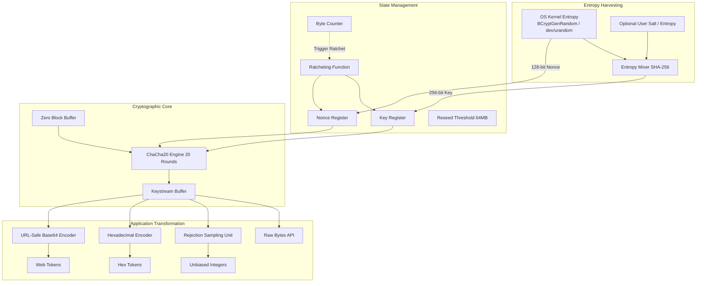

# System Architecture: ChaCha20 CSPRNG

## 1. Overview
The ChaCha20 Cryptographically Secure Pseudo-Random Number Generator (CSPRNG) is structured around four primary architectural tiers:
1. **Entropy Harvesting Layer**: Acquires physical/environmental entropy from the operating system kernel.
2. **State Management & Ratcheting Layer**: Manages the 256-bit symmetric cipher state, monitors byte counts, and triggers forward-secrecy ratcheting.
3. **Cryptographic Core Layer**: Uses the ChaCha20 stream cipher engine to expand seed entropy into computationally indistinguishable pseudo-random keystream.
4. **Application Transformation Layer**: Provides tailored consumer primitives (raw bytes, unbiased bounded integers, hex tokens, URL-safe tokens) while neutralizing vulnerabilities such as modulo bias.

## 2. Component Breakdown

### 2.1 Entropy Harvesting Layer
- **Source**: Operating system high-assurance entropy via `os.urandom()`. On Windows, this connects to `BCryptGenRandom`; on Linux, it invokes the `getrandom()` system call.
- **Mixer**: SHA-256 cryptographic hash function compresses new OS entropy, existing state, and any user-supplied salt into a uniformly distributed 256-bit master key.

### 2.2 State Management & Ratcheting
- **Key Register**: Holds the 32-byte (256-bit) active ChaCha20 key.
- **Nonce Register**: Holds the 16-byte (128-bit) nonce.
- **Byte Counter**: Accumulates bytes emitted. When the counter exceeds the reseed threshold, the generator generates 48 bytes of keystream, updates the key and nonce, resets the counter, and erases the old state. This guarantees **forward secrecy** (backtrack resistance).

### 2.3 Cryptographic Core
- The core uses ChaCha20 as formalized in RFC 7539 / RFC 8439.
- Keystream is produced by encrypting a continuous block of null bytes (`\x00`).
- Because ChaCha20 acts as a pseudo-random permutation under a secret key, the resulting keystream is indistinguishable from true randomness to any polynomial-time adversary.

### 2.4 Application Transformation
- **`random_bytes(N)`**: Emits $N$ raw bytes.
- **`random_int(min, max)`**: Extracts enough bytes to encompass the span $(max - min + 1)$ and performs rejection sampling to discard numbers in the biased modulo overhang.
- **`random_hex(N)`**: Emits $2N$ hex characters.
- **`random_urlsafe(N)`**: Emits unpadded URL-safe base64 tokens suitable for HTTP query strings and cookies.
