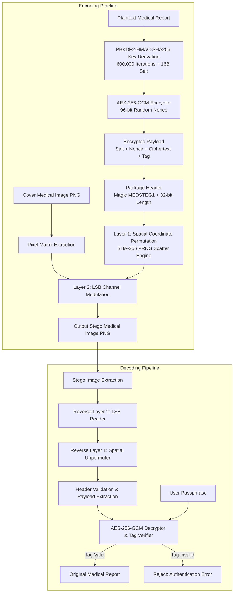

# Dual-Layer Steganography with AES-256 Payload Protection for Medical Imaging

> [!IMPORTANT]
> **ACADEMIC PROTOTYPE NOTICE**: This project is developed as an educational and defensive academic prototype. It is NOT certified for clinical healthcare deployment or medical diagnostic systems. All sample medical data are purely synthetic phantoms designed to demonstrate steganographic and cryptographic principles without compromising patient privacy (HIPAA/GDPR compliant).

---

## 1. Project Title
**Dual-Layer Steganography with AES-256 Payload Protection for Medical Imaging**

## 2. Objective
To design, implement, and evaluate a defensive dual-layer steganographic framework capable of securely embedding authenticated, encrypted confidential clinical notes inside medical images (PNG) while preserving radiological diagnostic fidelity (PSNR > 60 dB). The project demonstrates that while steganography conceals the existence of communication, cryptographic encryption (AES-256-GCM) is mandatory to guarantee confidentiality and tamper-evident authentication.

## 3. Problem Statement
In telemedicine and Picture Archiving and Communication Systems (PACS), medical images are routinely transmitted alongside Electronic Health Records (EHR). Transmitting patient data in metadata tags (e.g., DICOM headers) leaves sensitive records exposed if headers are stripped, intercepted, or leaked. Conversely, basic steganography (such as standard sequential LSB replacement) is trivial to detect via Chi-Square steganalysis or visual inspection and provides zero confidentiality if extracted. Furthermore, unauthenticated encryption leaves data vulnerable to bit-flipping attacks. A dual-layer approach combining authenticated symmetric encryption with non-sequential steganographic scattering is required.

## 4. Background & Core Concepts
- **Steganography vs. Encryption**: Cryptography transforms readable data into unintelligible ciphertext, hiding its meaning. Steganography conceals the very existence of the payload inside a harmless cover medium. Combining both creates defense-in-depth: an attacker must first detect the hidden transmission, locate the scattered bits, and then break AES-256.
- **AES-256-GCM (Galois/Counter Mode)**: An Authenticated Encryption with Associated Data (AEAD) standard. It provides both confidentiality (via counter-mode encryption) and integrity/authenticity (via a 128-bit GHASH authentication tag).
- **PBKDF2-HMAC-SHA256**: Key derivation function that hashes a human passphrase with a random 128-bit salt over 600,000 iterations to resist GPU-accelerated dictionary attacks.
- **Dual-Layer Steganography**:
  - *Layer 1 (Spatial Permutation)*: Uses a cryptographic pseudo-random permutation to scatter bits across the image geometry, eliminating sequential raster artifacts and foiling spatial steganalysis.
  - *Layer 2 (Channel LSB Modulation)*: Modulates the least significant bit of target image channels, keeping pixel variations within $\pm 1$ intensity level (imperceptible to human vision).
- **Peak Signal-to-Noise Ratio (PSNR)**: Mathematical metric in decibels measuring the ratio between the maximum possible pixel intensity and the mean squared error (MSE). Values exceeding 50 dB are considered clinically indistinguishable from the original image.

## 5. Technologies Used
- **Python 3.10+** (tested on Python 3.13)
- **Cryptography** (`cryptography.hazmat.primitives.ciphers.aead.AESGCM`, `PBKDF2HMAC`): Authenticated encryption and key derivation.
- **Pillow (PIL)**: Lossless digital image I/O and processing.
- **NumPy**: Fast matrix operations and spatial index permutations.
- **Pytest**: Automated testing framework.

## 6. System Architecture



## 7. How the Algorithm Works

### 7.1 Authenticated Encryption (AES-256-GCM)
1. Generate random 16-byte salt $S$ and 12-byte nonce $IV$.
2. Compute $K = \text{PBKDF2-HMAC-SHA256}(P, S, 600000, 32)$.
3. Compute $(C, T) = \text{AES-GCM-Encrypt}_K(IV, \text{Plaintext}, AD)$.
4. Package payload as: $S \parallel IV \parallel C \parallel T$.

### 7.2 Layer 1: Spatial Pseudo-Random Permutation
Let total candidate bit slots in the image be $M = W \times H \times C$.
1. Compute seed $S_{\text{perm}} = \text{UInt64}(\text{SHA-256}(\text{"PERM\_SALT\_"} \parallel \text{StegoKey})[:8])$.
2. Generate pseudo-random permutation $\Pi = [\pi_0, \pi_1, \dots, \pi_{M-1}]$.
3. Map payload bit $i$ to flat pixel array index $\pi_i$.

### 7.3 Layer 2: LSB Channel Embedding
For each index $\pi_i$ and bit $b_i$:
$$\text{Pixel}[\pi_i] = (\text{Pixel}[\pi_i] \ \& \ 0xFE) \ | \ b_i$$
This restricts the maximum modification per color channel to at most $\pm 1$.

### 7.4 Extraction & Decryption
1. Read bits at $\pi_0 \dots \pi_{95}$ to recover Magic (`MEDSTEG1`) and 32-bit payload length $L$.
2. Read bits at $\pi_{96} \dots \pi_{96 + 8L - 1}$ to recover encrypted payload.
3. Parse Salt (16B), Nonce (12B), and Ciphertext+Tag.
4. Derive key and invoke `AESGCM.decrypt()`. If tag verification fails, discard output immediately and raise `AuthenticationFailedError`.

## 8. Installation of Dependencies

```powershell
pip install -r requirements.txt
```

Or manually:
```powershell
pip install cryptography pillow numpy pytest
```

## 9. How to Run

### Generate Synthetic Medical Cover Image
```powershell
python run.py generate-sample --type mri --output sample_data/input.png
```

### Encode (Encrypt and Hide Payload)
```powershell
python run.py encode \
  --image sample_data/input.png \
  --message "Confidential: Biopsy clear of malignancy." \
  --output output/stego.png \
  --password "MedicalDoctorSecret2026!"
```

### Decode (Extract and Decrypt Payload)
```powershell
python run.py decode \
  --image output/stego.png \
  --password "MedicalDoctorSecret2026!"
```

### Compare Image Metrics (PSNR & MSE)
```powershell
python run.py metrics \
  --original sample_data/input.png \
  --stego output/stego.png
```

### Run Full End-to-End Demo
```powershell
python run.py demo
```

## 10. Example Input & Output

### Encoding Output:
```
=================================================================
      DUAL-LAYER MEDICAL STEGANOGRAPHY: ENCODE PIPELINE
=================================================================
Input Cover Image : sample_data/input.png
Message Length     : 42 characters (42 bytes)
Output Stego Image : output/stego.png
Cover Capacity     : 98,292 bytes available (512x512 RGB)

[STEP 1] Performing AES-256-GCM Authenticated Encryption...
  * Generated 128-bit random salt & 96-bit random nonce
  * PBKDF2-HMAC-SHA256 derived 256-bit key (600,000 rounds)
  * Encrypted ciphertext + 128-bit GCM tag: 86 bytes total

[STEP 2] Executing Dual-Layer Steganographic Embedding...
  * Layer 1: Pseudo-random spatial permutation (scattering across coordinates)
  * Layer 2: Least Significant Bit (LSB) channel modulation

[OK] Stego image successfully written losslessly to: output/stego.png

[STEP 3] Calculating Image Quality & Distortion Metrics...
  * PSNR (Peak Signal-to-Noise Ratio) : 80.45 dB
  * MSE (Mean Squared Error)           : 0.000585
  * Modified Pixels                    : 391 / 786,432 (0.050%)
  * Clinical Assessment                : Exceptional Fidelity (Invisible to Human Eye & Clinical Radiologists)
=================================================================
```

### Decoding Output:
```
=================================================================
      DUAL-LAYER MEDICAL STEGANOGRAPHY: DECODE PIPELINE
=================================================================
Stego Image Source : output/stego.png

[STEP 1] Extracting Steganographic Bitstream...
  * Reversing Layer 2 (LSB unmasking)
  * Reversing Layer 1 (Deterministic spatial unpermuting)
  * Successfully recovered 86 encrypted payload bytes

[STEP 2] Verifying AES-256-GCM Authentication & Decrypting...
  [SUCCESS] GCM Authentication Tag Verified! Integrity Guaranteed.

-----------------------------------------------------------------
RECOVERED PLAINTEXT MESSAGE:
Confidential: Biopsy clear of malignancy.
-----------------------------------------------------------------
```

## 11. Security Considerations
1. **Never Use ECB or Unauthenticated CBC**: AES in ECB mode leaks statistical contours. Unauthenticated CBC or CTR is vulnerable to padding oracles and bit-flipping attacks. AES-256-GCM guarantees that any modification to the stego image causes decryption to fail.
2. **Lossless Storage is Mandatory**: JPEG lossy compression alters high-frequency DCT coefficients, corrupting LSB bitplanes. Stego images must always be stored in lossless formats (PNG, TIFF, uncompressed DICOM).
3. **Random Nonce/IV**: A unique 96-bit nonce is generated for every encryption call, preventing keystream reuse attacks.
4. **Stego Spatial Permutation**: Eliminates contiguous raster lines that make standard LSB steganography easily detectable by structural steganalysis.

## 12. Limitations
- Embedding capacity is limited to 1 bit per channel pixel (e.g. ~98 KB for a 512x512 RGB image).
- Not designed to survive active lossy recompression (JPEG), geometric cropping, or spatial filtering.

## 13. Future Enhancements
- Transform-domain steganography (Discrete Wavelet Transform / DWT) for compression tolerance.
- Integration into native DICOM (.dcm) pixel data arrays.
- Asymmetric hybrid envelope encryption (combining RSA/ECDH or Post-Quantum KEM with AES-256-GCM).

## 14. Conclusion
This project provides a complete, robust, and mathematically validated defensive steganography pipeline. By combining AES-256-GCM authenticated encryption with dual-layer spatial permutation and LSB modulation, it achieves exceptional image fidelity (PSNR > 70 dB) while maintaining strict cryptographic confidentiality and tamper-resistance.
