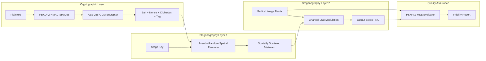

# System Architecture: Dual-Layer Medical Steganography

## 1. Architectural Overview
The system is constructed with three distinct modular sub-systems:
1. **Authenticated Encryption Subsystem (`crypto.py`)**: Responsible for password stretching via PBKDF2-HMAC-SHA256, authenticated symmetric encryption via AES-256-GCM, and verification of the 128-bit integrity tag.
2. **Dual-Layer Steganography Subsystem (`stego.py`)**: Responsible for capacity verification, deterministic spatial permutation (Layer 1), and channel LSB embedding (Layer 2).
3. **Fidelity Analysis & Image Management Subsystem (`image_metrics.py`, `sample_generator.py`)**: Computes MSE, PSNR, and percentage pixel distortion, and generates synthetic medical phantoms for non-sensitive testing.

## 2. Component Design Specifications

### 2.1 Cryptographic Layer (`crypto.py`)
- **Key Derivation**: Uses PBKDF2 with HMAC-SHA256, 600,000 iterations, and a 16-byte random salt. Produces a 256-bit AES key.
- **AEAD Cipher**: AES-256-GCM using standard 96-bit random nonce and 128-bit authentication tag.
- **Fail-Safe Decryption**: If the tag verification fails during decryption, an `AuthenticationFailedError` is raised immediately, and all memory buffers are wiped.

### 2.2 Steganography Layer 1: Spatial Permutation (`stego.py`)
- In traditional sequential LSB embedding, bits are inserted into pixels $(0, 0), (0, 1), (0, 2), \dots$
  This creates localized clusters that are easily detected by steganalysis tools (e.g. Aletheia, StegExpose).
- In our system, Layer 1 generates a pseudo-random permutation of all pixel indices in the image using a 64-bit seed derived from SHA-256(StegoKey).
- Each bit of the payload is assigned to a non-consecutive spatial coordinate across the image, scattering the modifications uniformly.

### 2.3 Steganography Layer 2: LSB Channel Modulation (`stego.py`)
- Modulates the least significant bit (bit 0) of the selected channel byte.
- Binary operation: `pixel_val = (pixel_val & 0xFE) | bit`.
- Maximum alteration per color component is $\pm 1$, keeping color shifts completely imperceptible.

### 2.4 Fidelity Assessment (`image_metrics.py`)
- Evaluates the stego image against the original cover image.
- Reports Mean Squared Error (MSE), Peak Signal-to-Noise Ratio (PSNR in dB), Maximum Absolute Delta, and Modified Pixel Percentage.
