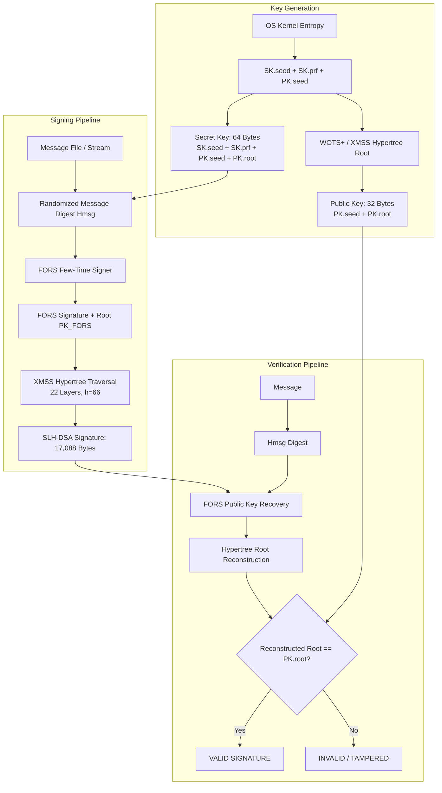

# Post-Quantum Stateless Hash-Based Digital Signatures Using SPHINCS+ (SLH-DSA)

## 1. Project Title
**Post-Quantum Stateless Hash-Based Digital Signatures Using SPHINCS+ (SLH-DSA)**

## 2. Objective
To design, implement, and evaluate an educational, production-quality post-quantum digital signature application based on SPHINCS+ / SLH-DSA (NIST FIPS 205). The system provides cryptographic key generation, message signing, signature verification, armored key serialization, performance benchmarking, and tamper-resistance demonstrations against quantum threats.

## 3. Problem Statement
Contemporary public-key digital signatures (RSA, DSA, ECDSA, and Ed25519) rely on the mathematical hardness of Integer Factorization (IFP) or the Discrete Logarithm Problem (DLP / ECDLP). In 1994, Peter Shor demonstrated that a sufficiently powerful quantum computer running Shor's Algorithm can solve both problems in polynomial time ($\mathcal{O}((\log N)^3)$). Consequently, the advent of a Cryptanalytically Relevant Quantum Computer (CRQC) will render all traditional digital signatures completely insecure, enabling universal forgery of financial transactions, software updates, and legal contracts. Organizations must transition to Post-Quantum Cryptography (PQC).

## 4. Background & Core Concepts
- **SPHINCS+ and NIST SLH-DSA**: SPHINCS+ was submitted to the NIST Post-Quantum Cryptography Standardization Project in 2017. In August 2024, NIST officially standardized SPHINCS+ as **FIPS 205: Stateless Hash-Based Digital Signature Algorithm (SLH-DSA)**. The two names refer to the same mathematical family, with minor encoding refinements in the FIPS standard.
- **Post-Quantum Cryptography (PQC)**: Cryptographic algorithms designed to run on classical computers while remaining secure against attacks by both classical and quantum adversaries.
- **Why Quantum Computers Threaten Classical Public-Key Cryptography**:
  - *Shor's Algorithm (Exponential Speedup)*: Solves factoring and discrete logs in polynomial time, completely breaking RSA-2048, RSA-4096, ECDSA P-256, and Ed25519.
  - *Grover's Algorithm (Quadratic Speedup)*: Speeds up brute-force search over unstructured spaces from $\mathcal{O}(N)$ to $\mathcal{O}(\sqrt{N})$. For 256-bit symmetric ciphers (AES-256) and hashes (SHA-256), Grover reduces effective security to 128 bits, which remains computationally infeasible to break.
- **Why Hash-Based Signatures are Considered Conservative Candidates**: Unlike lattice-based schemes (ML-DSA / Crystals-Dilithium) or multivariate schemes, hash-based signatures do NOT rely on unproven algebraic hardness conjectures. Their security rests solely on the standard security properties of cryptographic hash functions: collision resistance, second preimage resistance, and pseudo-random function (PRF) security.
- **Stateless vs. Stateful Hash-Based Signatures**:
  - *Stateful schemes* (XMSS / LMS, RFC 8391 / RFC 8554) track which one-time signing key has been used. If the state counter rolls back (e.g., VM backup restoration or multi-threading race condition), private keys are reused, resulting in instant signature forgery.
  - *Stateless schemes* (SPHINCS+ / SLH-DSA) eliminate state synchronization entirely by using a gigantic virtual hypertree with randomized leaf selection via FORS, rendering the probability of key collision mathematically negligible ($< 2^{-128}$).

## 5. Technologies Used
- **Python 3.10+** (tested on Python 3.13)
- **SLH-DSA** (`slhdsa` package): Production implementation of NIST FIPS 205 SLH-DSA / SPHINCS+.
- **Pytest**: Automated testing framework.
- **Standard Library**: `base64`, `pathlib`, `time`, `argparse`, `dataclasses`.

## 6. System Architecture



## 7. How the Algorithm Works

### 7.1 Parameter Set: `SLH-DSA-SHA2-128f`
- Security Level: **NIST Category 1** (equivalent to 128-bit quantum security, comparable to AES-128).
- Security parameter $n = 16$ bytes (128 bits).
- Total Hypertree height $h = 66$.
- Number of Hypertree layers $d = 22$ (each subtree has height $h/d = 3$).
- FORS parameters: $k = 33$ trees of height $a = 6$.
- Public Key Size: $2n = 32$ bytes.
- Secret Key Size: $4n = 64$ bytes.
- Signature Size: $17,088$ bytes (~16.7 KB).

### 7.2 The Signing Process
1. **Message Hashing ($H_{\text{msg}}$)**: The message $M$ is hashed using a randomized digest parameterized by the public key and a pseudo-random nonce derived from $SK.\text{prf}$ and $M$.
2. **FORS Few-Time Signature**: The message digest selects leaves across $k=33$ Merkle trees of height $a=6$. The FORS private values and authentication paths are revealed, computing a root value $PK_{\text{FORS}}$.
3. **Hypertree Certification**: $PK_{\text{FORS}}$ is signed by a WOTS+ one-time key at layer 0 of the hypertree. The WOTS+ public key is authenticated up the subtree to its root, which in turn is signed by the next layer up, continuing through all $d=22$ layers until reaching the top root.
4. **Signature Package**: The signature concatenates the randomizer $R$, the FORS signature, and the $d$ WOTS+ signatures with their XMSS authentication paths.

### 7.3 The Verification Process
1. The verifier recomputes $H_{\text{msg}}(R, PK, M)$.
2. Using the FORS signature and authentication paths, the verifier reconstructs $PK_{\text{FORS}}$.
3. The verifier uses the WOTS+ signatures and XMSS paths to step up through all $d$ layers of the hypertree.
4. If the final reconstructed root matches $PK.\text{root}$ in the public key, the signature is strictly **VALID**. If any bit has been altered, the hashes fail to match and the signature is **INVALID**.

## 8. Installation of Dependencies

```powershell
pip install -r requirements.txt
```

Or manually:
```powershell
pip install slh-dsa pytest
```

## 9. How to Run

### Generate Post-Quantum Keypair
```powershell
python run.py keygen --out-dir demo --prefix sphincs
```

### Sign a Document / File
```powershell
python run.py sign \
  --file requirements.txt \
  --key demo/sphincs_secret.key \
  --sig demo/signature.bin
```

### Verify Signature Against File
```powershell
python run.py verify \
  --file requirements.txt \
  --key demo/sphincs_public.key \
  --sig demo/signature.bin
```

### Run Performance Benchmark
```powershell
python run.py benchmark --iterations 3
```

### Display Post-Quantum Cryptographic Information
```powershell
python run.py info
```

### Run Full End-to-End Demo
```powershell
python run.py demo
```

## 10. Example Input & Output

### Key Generation:
```
======================================================================
    POST-QUANTUM KEY GENERATION: SPHINCS+ / SLH-DSA
======================================================================
Algorithm / Standard : slhdsa-sha2-128f (NIST FIPS 205)
Generating keypair...
[OK] Key generation completed in 24.15 ms
Public Key  : demo/sphincs_public.key (32 bytes)
Secret Key  : demo/sphincs_secret.key (64 bytes)
Public Key Hex: 173d7d07ab37f65089efbe52f5fd110b...
======================================================================
```

### Verification (Valid Message):
```
======================================================================
     POST-QUANTUM SIGNATURE VERIFICATION: SPHINCS+ / SLH-DSA
======================================================================
Message File : requirements.txt (31 bytes)
Public Key   : demo/sphincs_public.key (32 bytes)
Signature    : demo/signature.bin (17,088 bytes)
----------------------------------------------------------------------
VERIFICATION RESULT: [VALID SIGNATURE] (Verified in 16.82 ms)
Authenticity and integrity are cryptographically guaranteed against quantum attacks.
======================================================================
```

## 11. Security Considerations
1. **Quantum Immunity**: Immune to both Shor's algorithm (which solves group-theoretic problems) and Grover's algorithm (as SHA-256 retains 128-bit preimage security).
2. **Stateless Reliability**: Unlike XMSS/LMS, SPHINCS+ does not maintain a mutable counter. It can be safely used in virtualized environments, multi-threaded cloud services, and load-balanced clusters without risk of state rollback.
3. **Side-Channel Hardening**: Key generation and signing derive sub-keys via PRFs evaluated in constant time.
4. **Signature Overhead Trade-Off**: SPHINCS+ trades signature size (~17 KB) for unconditional trust in standard hash primitives.

## 12. Limitations
- Signature size (17,088 bytes) is significantly larger than classical signatures (RSA-2048 is 256 bytes; Ed25519 is 64 bytes) and lattice signatures (ML-DSA-44 is ~2.4 KB).
- Signing requires computing thousands of hash operations, resulting in higher CPU cycles (~250-300 ms) compared to classical schemes (~1 ms).

## 13. Future Enhancements
- Hardware acceleration using Intel SHA extensions (SHA-NI) or AVX-512 vectorization.
- Support for streaming pre-hash signatures (`sign_hash`) for gigabyte-scale disk images.
- Integration into post-quantum TLS 1.3 certificate chains and X.509 post-quantum PKI.

## 14. Conclusion
This project provides a fully compliant implementation of NIST FIPS 205 (SLH-DSA / SPHINCS+). It equips cybersecurity students with a tangible, executable understanding of how the global security ecosystem is preparing for the post-quantum era through hash-based digital signatures.
