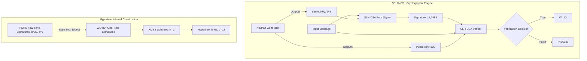

# System Architecture: SPHINCS+ / SLH-DSA Post-Quantum Signatures

## 1. Architectural Overview
The SPHINCS+ system comprises three distinct architectural components:
1. **Engine Core Layer (`sphincs_engine.py`)**: Wraps the NIST FIPS 205 SLH-DSA cryptographic primitive (`slhdsa`), providing keypair creation, message signing, and signature verification.
2. **Key & Artifact Serialization Layer (`sphincs_engine.py`)**: Encodes and decodes keys into ASCII armored (PEM-style) or binary formats, and handles disk storage.
3. **Metadata & Cryptographic Analysis Layer (`metadata.py`)**: Provides runtime parameter introspections, quantum threat models, and architectural specifications.

## 2. Component Design Specifications

### 2.1 The Hypertree Architecture
Rather than building a single monolithic Merkle tree of height $h=66$ (which would require computing $2^{66}$ hashes, an impossible task), SPHINCS+ organizes the tree into a **Hypertree** composed of $d = 22$ layers:
- Each layer contains multiple XMSS subtrees of height $h' = h/d = 66 / 22 = 3$.
- An XMSS tree of height 3 contains only $2^3 = 8$ leaves, which can be computed in microseconds.
- The root of each subtree at layer $i$ is signed by a WOTS+ one-time signature key attached to a leaf of the subtree in layer $i+1$.
- The root of the single top-layer tree is $PK.\text{root}$, which is published in the 32-byte public key.

### 2.2 FORS (Forest of Random Subsets)
- FORS is a Few-Time Signature (FTS) scheme.
- It consists of $k = 33$ small Merkle trees of height $a = 6$. Each tree has $2^6 = 64$ leaves.
- The message hash $H_{\text{msg}}$ is split into 33 indices of 6 bits each. Each 6-bit index selects one leaf in its corresponding FORS tree.
- The signature reveals the secret leaf values and their authentication paths. The roots of all $k$ trees are hashed together to form $PK_{\text{FORS}}$, which is then signed by the bottom of the hypertree.

### 2.3 Stateless Operation
Because $h=66$, the hypertree contains $2^{66} \approx 7.37 \times 10^{19}$ leaves. The randomized index selection means that an attacker signing $2^{30}$ (one billion) messages has a negligible probability of colliding on the same leaf. This guarantees that no one-time key is ever exhausted or reused, making the scheme completely stateless.
